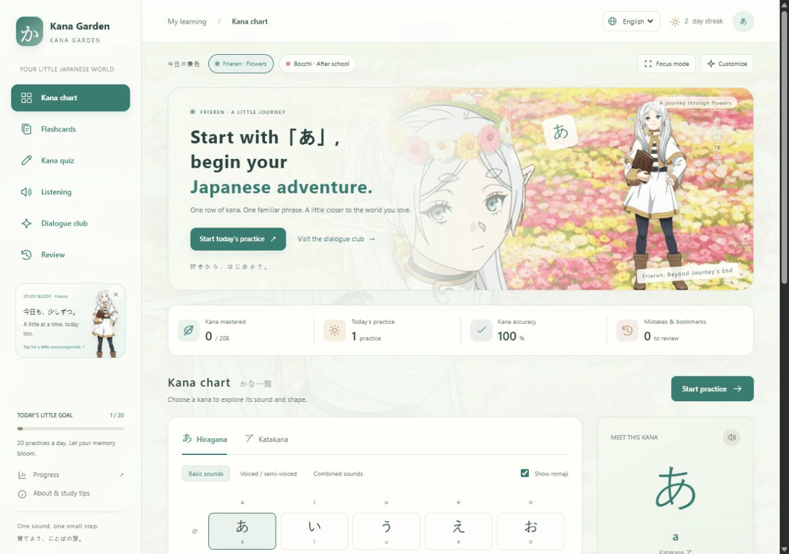

<div align="center">

# Kana Garden 🌸

### Your love of anime. Your first step into Japanese.

**Frieren's flowers. Bocchi's after-school world. And a familiar line you can finally read.**

[Start learning →](https://zhu888090.github.io/kana-garden/?lang=en) · [中文](README.md) · [한국어](README.ko.md)

Chinese · English · Korean | Mobile & desktop | No sign-up | Free static web app

</div>



Heard **ありがとう**, **大丈夫**, or **諦めない** in anime, but still finding your way around kana? Kana Garden turns that spark of interest into small, hands-on practice sessions.

## A little world to learn in

- **Pick your anime mood.** Switch between a *Frieren: Beyond Journey's End* flower-field theme and a *Bocchi the Rock!* after-school theme, with character artwork, backgrounds and a clickable study companion.
- **Learn a familiar phrase, one beat at a time.** Explore 24 everyday expressions with kana, romaji, meanings, original anime-style situations, usage notes and pronunciation tips.
- **Make your first kana stick.** Use the chart, flashcards, reading quizzes, romaji typing, listening practice and mistake review. There are 104 entries per script: 208 across hiragana and katakana.
- **Choose your interface language.** Chinese, English and Korean include the exercise instructions and dialogue content. Switching languages keeps your current question and progress.
- **Focus when you want to.** Hide the artwork temporarily with Focus mode, or customize the background and character display. Your appearance and language preferences are remembered.

## Try it

Open **[Kana Garden](https://zhu888090.github.io/kana-garden/?lang=en)**. Nothing to install, and no account to create. Change language with the selector at the top right.

Prefer a local copy? Download [`假名花园.html`](https://github.com/zhu888090/kana-garden/raw/refs/heads/main/%E5%81%87%E5%90%8D%E8%8A%B1%E5%9B%AD.html) and open it in a modern browser. The single file includes the code, translations and artwork.

1. Meet a row of kana in the chart.
2. Recall it with flashcards.
3. Try a short quiz, then revisit your mistakes.
4. Visit the Dialogue club and try a phrase you recognize.

## Good to know

Progress stays in the current browser; it does not automatically sync across devices. Export a JSON backup from Progress before clearing browser data or moving devices. Importing a backup replaces current progress. Appearance and language settings are stored separately from learning records.

Audio uses your device's Japanese speech-synthesis voice, not anime recordings or actor voices. Listening modes need an installed Japanese voice. The dialogue lessons use common expressions and original situations, rather than excerpts from specific shows.

This is an unofficial beginner-learning project. Characters and anime artwork belong to their respective rights holders. See the in-app credits and [artwork sources](README.md#动漫主题与图片来源).

## Run locally

```sh
python -m http.server 8765 --bind 127.0.0.1 --directory dist
```

Visit `http://127.0.0.1:8765`. The `dist/` folder can be hosted by any static-file host.

```sh
node --test tests/learning.test.cjs tests/dialogue.test.cjs tests/i18n.test.cjs
node make-portable.cjs
```

The app uses plain HTML, CSS and JavaScript. Translations live in `dist/locales.js`; display-language handling lives in `dist/i18n.js`. Japanese text, answer values and saved learning data are independent from the interface language.
