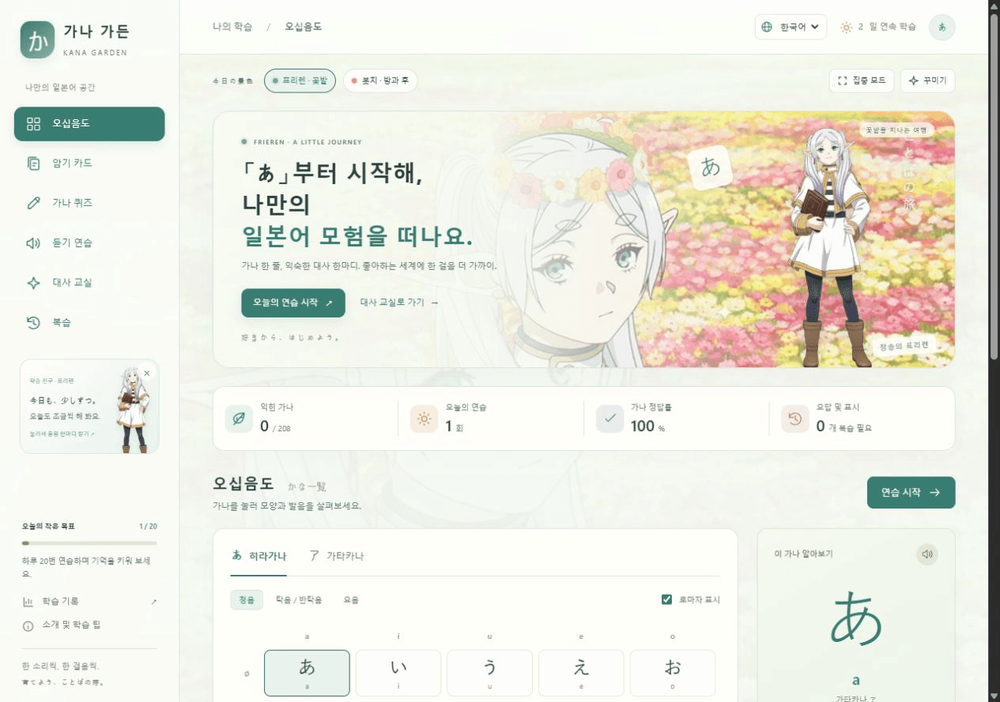

<div align="center">

# 가나 가든 · Kana Garden 🌸

### 좋아하는 애니에서 시작하는, 일본어의 첫걸음.

**프리렌의 꽃밭, 봇치의 방과 후, 그리고 드디어 읽을 수 있게 된 익숙한 대사 한마디.**

[한국어로 학습 시작 →](https://zhu888090.github.io/kana-garden/?lang=ko) · [中文](README.md) · [English](README.en.md)

중국어 · 영어 · 한국어 | 모바일·PC 지원 | 가입 없이 | 무료 정적 웹 앱

</div>



애니에서 **ありがとう**, **大丈夫**, **諦めない**를 여러 번 들었지만 가나는 아직 낯선가요? 가나 가든은 좋아하는 마음을 짧고 직접 해 보는 일본어 연습으로 이어 줍니다.

## 좋아하는 세계에서 조금씩 배우기

- **애니 분위기로 꾸미기.** 《장송의 프리렌》 꽃밭 테마와 《봇치 더 록!》 방과 후 테마를 선택하세요. 캐릭터 일러스트, 애니 배경, 누르면 응원 메시지를 보여 주는 학습 친구가 함께해요.
- **익숙한 대사를 한 박자씩 이해하기.** 자주 쓰는 표현 24개에 가나, 로마자, 뜻, 창작 애니풍 상황, 말투와 발음 설명이 있어요.
- **가나의 첫 기억을 단단하게.** 오십음도, 암기 카드, 선택형 퀴즈, 로마자 입력, 듣기와 오답 복습을 이용하세요. 히라가나·가타카나 각각 104개, 총 208개 항목이 있어요.
- **편한 언어로 학습하기.** 중국어·영어·한국어를 지원하며, 문제 안내와 대사 내용도 함께 바뀌어요. 언어를 바꿔도 현재 문제와 학습 기록은 유지돼요.
- **집중하고 싶은 순간에는 집중 모드.** 배경과 캐릭터를 잠시 숨길 수 있어요. 원하는 배경과 캐릭터 표시, 화면 언어 설정은 저장돼요.

## 바로 시작하기

**[가나 가든 열기](https://zhu888090.github.io/kana-garden/?lang=ko)**. 설치나 가입이 필요 없어요. 오른쪽 위에서 언어를 바꿀 수 있어요.

로컬에서 사용하려면 [`假名花园.html`](https://github.com/zhu888090/kana-garden/raw/refs/heads/main/%E5%81%87%E5%90%8D%E8%8A%B1%E5%9B%AD.html)을 내려받아 최신 브라우저로 여세요. 코드, 번역과 이미지가 한 파일에 들어 있어요.

1. 오십음도에서 가나 한 줄을 살펴봐요.
2. 암기 카드로 발음을 떠올려요.
3. 짧은 퀴즈를 풀고 오답을 복습해요.
4. 대사 교실에서 익숙한 표현을 찾아 연습해요.

## 이용 안내

학습 기록은 현재 브라우저에 저장되며 기기 사이에 자동으로 동기화되지 않아요. 브라우저 데이터를 지우거나 기기를 바꾸기 전에 학습 기록 메뉴에서 JSON 백업을 내보내세요. 백업을 가져오면 현재 기록이 바뀌어요. 꾸미기와 언어 설정은 학습 기록과 별도로 저장돼요.

음성은 기기의 일본어 합성 음성을 사용해요. 애니 음원이나 성우 녹음이 아니며, 듣기 연습에는 일본어 음성 팩이 필요해요. 대사는 일상 표현과 창작 상황으로 구성되어 특정 작품의 장면을 인용하지 않아요.

초보자를 위한 비공식 학습 프로젝트예요. 캐릭터와 애니 이미지의 권리는 각 권리자에게 있어요. 앱 안의 출처 정보와 [이미지 출처](README.md#动漫主题与图片来源)를 확인하세요.

## 로컬 실행

```sh
python -m http.server 8765 --bind 127.0.0.1 --directory dist
```

`http://127.0.0.1:8765`를 여세요. `dist/` 폴더를 정적 웹 호스팅에 올려 사용할 수도 있어요.

```sh
node --test tests/learning.test.cjs tests/dialogue.test.cjs tests/i18n.test.cjs
node make-portable.cjs
```

HTML, CSS, JavaScript만으로 동작해요. 번역은 `dist/locales.js`, 언어 전환 처리는 `dist/i18n.js`에 있어요. 일본어 원문, 정답 값, 학습 데이터는 화면 언어와 분리되어 있어요.
