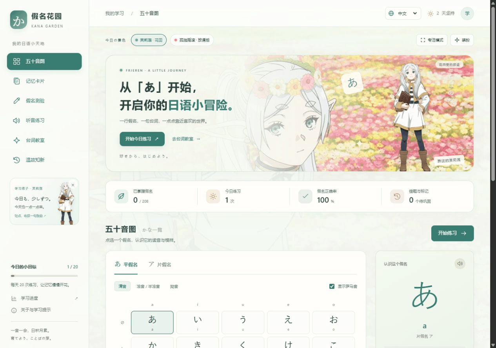
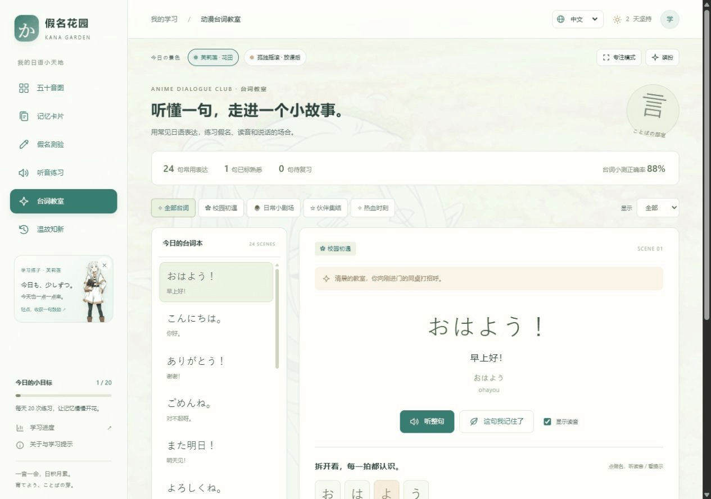
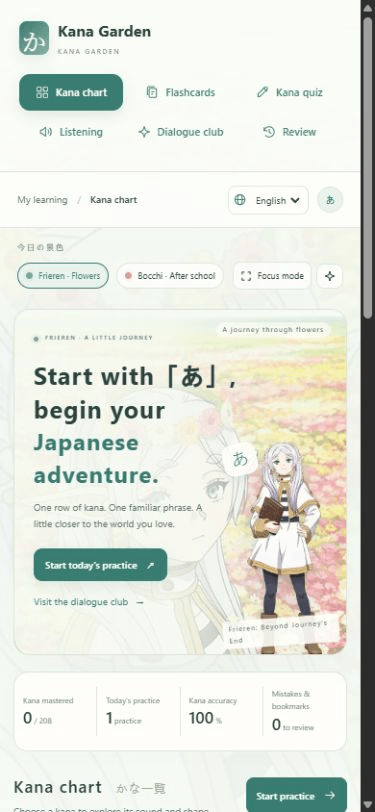
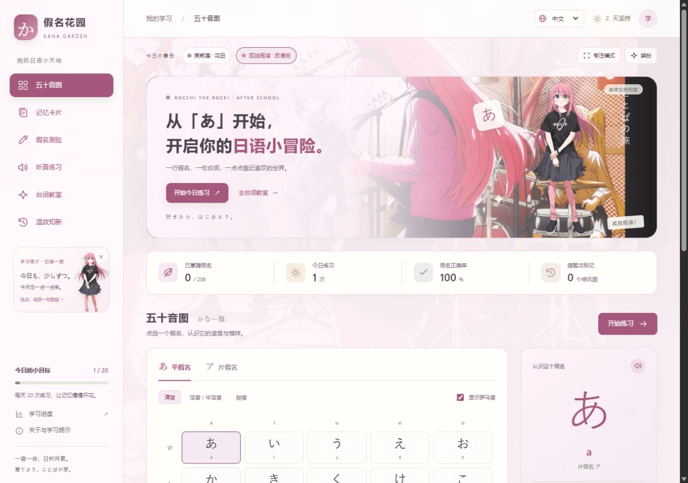

<div align="center">


# 假名花园 · Kana Garden

### 从喜欢的动漫开始，迈出学日语的第一步。

**芙莉莲的花田，波奇的放课后，还有一句终于读懂的「大丈夫」。**

为因为二次元而喜欢上日语的你，准备的轻量学习小天地。
认识平假名与片假名，把耳熟的表达拆成读得出的假名，再用小测验留住记忆。

**中文 · English · 한국어** | 电脑与手机 | 无需注册 | 免费静态网页

[🌸 中文开始](https://zhu888090.github.io/kana-garden/?lang=zh) · [✨ Start in English](https://zhu888090.github.io/kana-garden/?lang=en) · [🎸 한국어로 시작](https://zhu888090.github.io/kana-garden/?lang=ko)

[English README](README.en.md) · [한국어 README](README.ko.md) · [下载单文件版](https://github.com/zhu888090/kana-garden/raw/refs/heads/main/%E5%81%87%E5%90%8D%E8%8A%B1%E5%9B%AD.html)

</div>



## 喜欢动漫，也可以成为学习的起点

看番时听过很多次「ありがとう」「任せて」「諦めない」，却还不太认得假名？假名花园把这份熟悉感变成可以动手练习的小进步。

- **把学习空间变成喜欢的世界。** 切换《葬送的芙莉莲》花田主题与《孤独摇滚！》放课后主题，搭配角色立绘、动漫背景与可点击的学习挂件。
- **听熟悉的表达，理解每一拍。** 台词教室收录 24 句常见表达，提供假名、罗马音、释义、原创场景、使用语气和发音提示，还能做意思选择、假名填空与听音小测。
- **从「あ」开始，有自己的节奏。** 五十音图、翻转记忆卡、随机测验与错题复习，帮你把“好像听过”变成“这次记住了”。
- **用熟悉的语言学日语。** 右上角一键切换中文、English、한국어。导航、练习提示、台词释义、场景及学习说明同步切换，正在进行的题目保持不变。
- **想安静练习，就打开专注模式。** 临时收起背景和角色；外观与语言偏好会保留。学习记录存在当前浏览器，可以导出备份。

这是面向入门者的假名练习项目。台词采用通用表达与原创动漫风格情境，声音使用设备的日语合成语音。页面内展示图片来源与作品信息。

无需账号、后端或运行依赖，原生 HTML、CSS 和 JavaScript 即可运行。

## 功能介绍

| 功能 | 可以做什么 |
| --- | --- |
| 五十音图 | 切换平假名 / 片假名，查看清音、浊音、半浊音及常用拗音；显示或隐藏罗马音 |
| 记忆卡 | 先回忆，再翻面；通过「记住了 / 还没记住」进行自评 |
| 假名测验 | 看假名选罗马音、看罗马音选假名、输入罗马音 |
| 听音练习 | 播放设备的日语语音，选择对应假名 |
| 动漫台词教室 | 24 句表达、4 类场景、假名逐拍拆解、整句朗读、语气提示及台词小测 |
| 自选范围 | 按假名类型、发音分组、行与题量练习，同一轮内不重复 |
| 错题复习 | 答错的假名自动进入复习列表，也可以手动标记 |
| 间隔复习 | 根据连续记忆情况，在 1、3、7、14、30 天后安排页面内复习 |
| 学习进度 | 查看练习次数、测验正确率、连续学习天数及掌握情况 |
| 备份迁移 | 导出 / 导入 JSON 学习记录，方便更换设备 |
| 动漫装扮 | 花田 / 放课后主题、角色挂件、背景开关、专注模式；外观偏好自动保存 |
| 三语界面 | 中文、English、한국어；包括台词释义、场景、语气提示及练习反馈 |
| 手机与键盘 | 响应式布局，支持键盘快捷键和减少动态效果设置 |

每种文字收录 **104 个条目**：46 个清音（含拨音）、25 个浊音与半浊音、33 个常用拗音，两种文字共 **208 个条目**。

## 开始使用

### 在线打开

访问 **[假名花园在线版](https://zhu888090.github.io/kana-garden/)**，无需下载安装。支持电脑和手机浏览器。

### 界面语言

页面右上角可切换 **中文 / English / 한국어**，选择会在当前浏览器保存。也可以分享带 `?lang=en` 或 `?lang=ko` 的链接直接打开对应语言。日语原文、假名与罗马音保持不变；切换不会重置题目、答题结果或学习记录。

### 下载后直接打开

下载仓库中的 [`假名花园.html`](https://github.com/zhu888090/kana-garden/raw/refs/heads/main/%E5%81%87%E5%90%8D%E8%8A%B1%E5%9B%AD.html)，用 Edge、Chrome、Safari 等现代浏览器打开即可。这个文件已包含全部样式、学习逻辑和动漫图片，打开后无需额外下载图片。

直接以本地文件打开时，浏览器对进度保存的处理可能有所不同；移动或重命名文件也可能使原记录不可见。建议定期导出备份，或使用 HTTP 服务访问。

### 在本地运行网站版本

下载或克隆本仓库后，在项目目录执行：

```bash
python -m http.server 8765 --bind 127.0.0.1 --directory dist
```

浏览器打开 <http://127.0.0.1:8765>。也可以将 `dist/` 中的文件部署到任意支持静态文件的托管服务。

## 推荐的学习方式

1. 在五十音图认识一行假名，听读音并留意字形。
2. 进入记忆卡，先自己回忆，再翻面查看。
3. 做一轮 10 题小测验，检查实际记忆情况。
4. 在「温故知新」集中复习错题，第二天再回来看看。

连续记对 3 次会标记为已掌握；记错后重新累计。记忆卡自评和测验都会影响记忆状态，但**测验正确率只统计测验与听音题**，不包含卡片自评。

## 动漫台词教室

从「大丈夫」「任せて」「諦めない」等常见表达开始，把熟悉的动漫语境变成日语练习。



| 场景 | 表达举例 |
| --- | --- |
| 校园初遇 | おはよう、ありがとう、また明日 |
| 日常小剧场 | ただいま、おかえり、ちょっと待って |
| 伙伴集结 | 任せて、一緒に行こう、行くぞ |
| 热血时刻 | 大丈夫、頑張って、諦めない |

每句提供日文、假名、罗马音、中文 / 英语 / 韩语释义、原创场景与语气说明；可以听整句，或点选逐拍拆解的假名。重点解释促音「っ」、拗音「しょ / じょ」、长音，以及「こんにちは」末尾的「は」读 wa 等现象。

支持 **看台词选意思、补全缺失假名、听台词选意思** 三种小测。错题自动收进台词待复习列表，也可以手动标记熟悉的台词。台词小测正确率单独统计，答题计入每日练习次数，记录随 JSON 备份导入导出。

台词采用通用日语表达与原创情境，不对应特定作品片段；声音使用设备日语合成语音。

### 键盘快捷键

| 场景 | 操作 |
| --- | --- |
| 选择题 | `1`–`4` 选择答案，`Enter` 进入下一题 |
| 输入题 | `Enter` 确认答案，再按 `Enter` 进入下一题 |
| 记忆卡 | `Space` 翻面，`1` 还没记住，`2` 记住了 |

## 声音、读音与数据说明

- 发音使用浏览器 Speech Synthesis 的日语语音，设备需要提供可用的日语语音包。没有日语语音时，其余学习功能仍可使用。
- 本程序未包含录制的真人音频。单字合成语音可能与自然语流中的声调和音变有所不同。
- 输入题兼容 `shi / si`、`chi / ti`、`tsu / tu`、`fu / hu`、`ji / zi` 等常见写法；`ぢ` 另接受 `di`，`づ` 另接受 `du`。
- 反向题和听音题会避开同音假名的干扰选项。助词读法、促音、长音与拗音提示可在程序内查看。
- 学习记录使用当前浏览器的 `localStorage` 保存，不发送给学习数据服务器，也不会自动跨设备同步。
- 导入备份会替换当前记录。清除浏览器数据前，请先导出备份。
- 网站版本通过 HTTP(S) 打开一次后，支持的浏览器可缓存页面供离线访问；语音是否离线可用取决于设备。
- 复习提醒仅在程序内显示，关闭页面后不会发送通知。

<details>
<summary>查看手机界面</summary>



</details>

## 项目结构

```text
dist/                  网站文件，可直接部署
  index.html           页面入口
  style.css            响应式样式
  anime.css            动漫主题与装扮样式
  appearance.js        外观偏好、挂件与主题切换
  locales.js           英语、韩语翻译目录与台词内容
  i18n.js / i18n.css    语言切换与三语排版
  assets/              已压缩的角色立绘与动漫背景
  kana-data.js         假名与罗马音数据
  learning.js          判分、记忆状态与复习逻辑
  app.js               交互与页面渲染
  sw.js                离线缓存
tests/                 数据及浏览器功能检查
docs/screenshots/      项目界面截图
make-portable.cjs      生成单文件便携版
假名花园.html           可直接打开的完整单文件版
```

### 验证与维护

核心数据和学习逻辑检查仅需要 Node.js：

```bash
node --test tests/learning.test.cjs tests/dialogue.test.cjs tests/i18n.test.cjs
node --check dist/app.js
```

浏览器功能检查使用 Playwright，可选执行：

```bash
npm install
npx playwright install chromium
npm run test:browser
```

修改 `dist/` 中的代码后，重新生成单文件版：

```bash
node make-portable.cjs
```

## 相关项目

制作前检索并阅读了 [Type Kana](https://github.com/furudean/type-kana)、[Kana Practice](https://github.com/davidbelesp/kana-practice) 和 [KanaQuiz](https://github.com/skywind3000/KanaQuiz)，参考了自选范围、随机测验与薄弱假名复习等学习方式。本程序独立编写，未复制这些项目的源码或素材。

## 动漫主题与图片来源



在页面上方切换「芙莉莲 · 花田」与「孤独摇滚 · 放课后」，通过「装扮」控制背景及角色立绘。点击「专注模式」可暂时隐藏图片与挂件；退出后恢复原有外观。切换主题不会中断正在进行的测验。外观保存在 `kana-garden-appearance-v1`，与学习记录分开。

| 文件 | 内容与来源 |
| --- | --- |
| `dist/assets/frieren.webp` | 芙莉莲立绘，[官方角色页](https://frieren-anime.jp/character/chara_group1/1-1/)，原图 `https://frieren-anime.jp/wp-content/uploads/2023/08/chara01_full1.png` |
| `dist/assets/frieren-flowers.webp` | 第 2 话花田剧照，[官方剧情页](https://frieren-anime.jp/story/1st/ep02/)，原图 `https://frieren-anime.jp/wp-content/uploads/2023/09/02_08.jpg` |
| `dist/assets/bocchi.webp` | 后藤一里立绘，[Yamaha × 孤独摇滚！官方联动页](https://syncroom.yamaha.com/topics/2024/02.html)，原图 `https://syncroom.yamaha.com/assets/img/topics/2024/02/char-01.png` |
| `dist/assets/bocchi-band.webp` | 结束乐队主视觉，[Crunchyroll 公开介绍](https://www.crunchyroll.com/ar/news/latest/2022/9/17/-bocchi-the-rock--) |

图片仅为适配网页进行尺寸压缩、透明边距裁切与 WebP 转换。

© 山田鐘人・アベツカサ／小学館／「葬送のフリーレン」製作委員会  
© はまじあき／芳文社・アニプレックス

图片与角色权利归各自权利人所有；本仓库不授予第三方动漫素材的再许可。本站为非官方学习项目。挂件中的寄语是原创学习提示，台词教室仍使用通用表达与原创情境，不冒充作品原句或角色配音。
